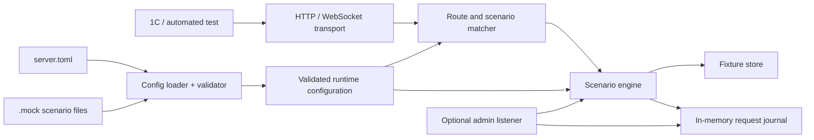

# Architecture

The transport layer normalizes requests. The matcher selects a route and scenario by explicit priority. The engine executes declarative actions. Fixtures are read from a configured root, with path traversal and symlink checks. Admin endpoints are served on a separate listener.

## Configuration layers

- `server.toml` contains runtime settings and the list of scenario files.
- `.mock` files declare routes and scenario behavior using the brace-delimited Mock DSL.
- Legacy YAML configuration remains supported for backwards compatibility.
- The loader parses the files into the existing typed configuration model and validates route/scenario references before startup or reload.

## Configuration reload

Hot reload loads and validates the complete configuration first, then swaps the HTTP handler only after validation succeeds. Listener addresses and server-level socket timeouts require a process restart. A reload creates a fresh scenario engine, resetting counters and in-memory state. Existing WebSocket sessions continue with the handler selected when their handshake was processed.

## Scenario engine

The matcher supports priority-based scenario selection, conditions for headers/query/path parameters, JSONPath, XML paths and request-body checks. Actions include responses, response sequences, delays, capture/state/assertion, abort and WebSocket send/expect/close. Asynchronous WebSocket sends can be scheduled independently of following scenario actions.

The JSONPath and XPath-like matchers implement documented subsets, not the complete standards. Their exact supported syntax is listed in `dsl-reference.md`.

## OpenAPI compatibility direction

The DSL separates route declarations from scenario behavior and uses stable IDs, explicit HTTP methods and structured response bodies. An OpenAPI generator can therefore emit `.mock` route declarations and initial scenarios without changing the runtime engine. Hand-authored behavior such as delays, sequences, state and asynchronous WebSocket events remains expressible in the same format.
